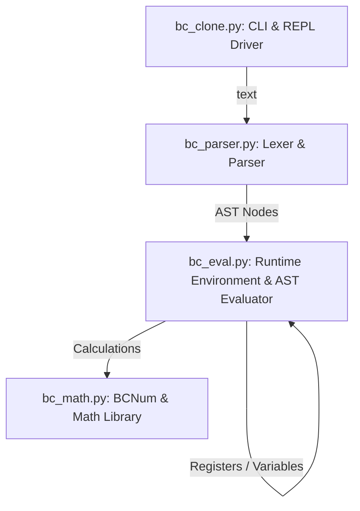

# Developer & Agent Guide: `bc-clone`

This document details the system design, core logic decisions, and code layout of the `bc` clone. It serves as an onboarding guide and architecture reference for future AI agents or developer workflows extending or refactoring this project.

---

## Architectural Principles

1. **Self-Contained Implementation**: The codebase operates without any runtime dependency outside the Python Standard Library.
2. **Deterministic Scoping**: Conforms to the POSIX specification for dynamic scope allocation of functions and variables.
3. **Differential Stability**: Every parser node and arithmetic computation is tested against the standard POSIX `bc` interpreter.

---

## Technical Details & Module Structures

### 1. `bc_math.py`: Custom Arbitrary-Precision Math (`BCNum`)
Standard Python `decimal.Decimal` does not align well with the POSIX `bc` specification for scale arithmetic, base conversion, and truncation rules. Thus, `bc_math.py` implements a custom `BCNum` class:
* **Internal Representation**: A `BCNum` is defined by an integer `coefficient` and an integer `scale` (e.g., `12.34` is stored as coefficient `1234` and scale `2`).
* **Scale Resolution**: Arithmetic operations compute the output scale dynamically based on the operands and the global `scale` register.
  * **Addition / Subtraction**: Output scale is $\max(\text{scale}_1, \text{scale}_2)$.
  * **Multiplication**: Output scale is $\min(\text{scale}_1 + \text{scale}_2, \max(\text{global\_scale}, \text{scale}_1, \text{scale}_2))$.
  * **Division**: Output scale is always the global `scale` register.
  * **Exponentiation**: Conformant to POSIX scaling rules depending on whether the exponent is negative or positive.
* **Math Library Functions**: Uses Taylor series approximations to compute trigonometric, logarithmic, and exponential results up to the target scale. Pre-conditions are verified inside the class to maintain bounds stability.

### 2. `bc_parser.py`: Lexer & AST Nodes
* **Lexer**: Tokenizes inputs incrementally. It supports standard POSIX comments (`/* ... */`), string literals, backslash-newlines (ignored whitespace), and numbers/identifiers.
* **Parser**: Recursive descent parser.
  * It translates statement blocks, loops, function definitions, parameters, and global arrays into AST nodes (`Program`, `FuncDef`, `IfStmt`, `WhileStmt`, `ForStmt`, `Assign`, etc.).
  * **NoReturn Errors**: The lexer and parser utilize `self.error()` which throws a `SyntaxError` and is annotated as returning `NoReturn`. When modifying control flows or adding error checks, do **not** add return statements after calling `self.error()`, as doing so results in dead code (violating 100% test coverage rules). Instead, mark the containing function/method with `# noqa: RET503` if Ruff requests an explicit return signature.
  * **GNU Return Extension**: While POSIX standard grammar defines the value-returning syntax as `Return '(' return_expression ')'` (mandating enclosing parentheses), this implementation includes a GNU `bc` extension. It detects if a `return` token is followed by a token other than a statement terminator (like `NEWLINE`, `SEMICOLON`, `RBRACE`, or `EOF`) and parses it as a standalone expression, making it compatible with non-parenthesized return statements.

### 3. `bc_eval.py`: Scoping & Evaluation
* **Dynamic Scoping**: `bc` utilizes dynamic scoping. When a function is called, variables/arrays declared in the `auto` list or as parameters must shadow their previous values.
  * This is implemented in `Environment` via stack-like variable registries (`self.vars: dict[str, list[BCNum]]` and `self.arrays: dict[str, list[dict[int, BCNum]]]`).
  * On function entry, a new value is pushed to the stack for each parameter and auto variable. On exit, these values are popped, restoring the caller's scope state.
* **Base Conversion**: 
  * `ibase` (input base) is used by the Lexer/Parser to read constants. Note that digits `A` through `F` are always treated as having value 10 to 15 regardless of the value of `ibase`.
  * `obase` (output base) is handled during print formatting in `bc_eval.py` by recursively dividing the integer part of `BCNum` by `obase` to fetch digits, and multiplying the fractional part by `obase`.

### 4. `bc_clone.py`: CLI Driver and REPL
* Wraps the lexer, parser, and evaluator.
* Operates in two main loops: file-processing/piped-input, and interactive REPL.
* In interactive mode, errors (e.g. `ZeroDivisionError`, `SyntaxError`) are caught, printed to `stderr` with a clean traceback summary, and the environment is preserved for the next line of input.

---

## Extension Guidelines for Future Agents

### Adding a New AST Node / Statement
1. Define the node class in `bc_parser.py` (inheriting from `ASTNode`).
2. Add parser rules in `bc_parser.py` to recognize the syntax and build the node.
3. Add a corresponding `eval_...` method or visitor block in `bc_eval.py`'s `Evaluator` class.
4. Add differential test cases in `test_bc.py` to verify matching behavior with system `bc`.

### Modifying the Math Library
* Trigonometric or transcendental computations in `bc_math.py` should be computed to a higher intermediate precision (typically `scale + 5`) to prevent rounding errors before truncation to the final `scale`.

---

## Known Quirks to Keep in Mind
* **Print Truncation**: Fractional printing for bases other than 10 does not round; it truncates matching `bc` specification.
* **Variable Stacking**: Ensure `Environment.push_scope()` and `Environment.pop_scope()` are always balanced (using `try...finally` in the evaluator).
* **Dead Code vs. Coverage**: The coverage runner `pytest-cov` is strict. Do not add unreachable code or fallback returns inside blocks that are analytically terminal.
